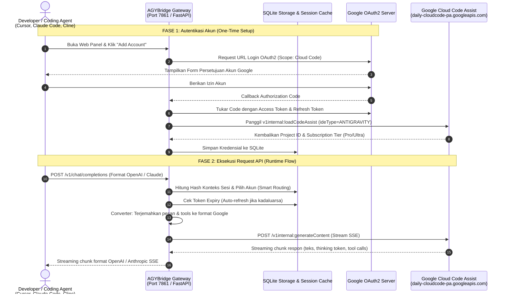

# Panduan Lengkap & Cara Kerja AGYBridge Gateway

Dokumen ini menjelaskan arsitektur, cara kerja mendalam, alur data end-to-end, dan potensi integrasi **AGYBridge Gateway** ([kyiov/agybridge](https://github.com/kyiov/agybridge)) dengan ekosistem Google Session Manager (**Chroma**).

---

## 1. Ikhtisar & Tujuan AGYBridge

**AGYBridge** adalah *High-Performance API Gateway & Reverse Proxy* berbasis Python (FastAPI) dan antarmuka web modern (React + Tailwind).

Tujuan utama AGYBridge adalah menjembatani akun **Google Antigravity / Google Cloud Code Assist** menjadi endpoint API standar yang kompatibel secara drop-in dengan:
* **OpenAI API** (`/v1/chat/completions`)
* **Anthropic Claude API** (`/v1/messages`)
* **Google Gemini API** (`/v1beta/models/...`)

Dengan gateway ini, developer dapat menggunakan model-model unggulan seperti **`claude-sonnet-4-6`**, **`gemini-3.8-flash-high`**, dan **`gemini-2.5-pro`** secara langsung di berbagai Coding Agent seperti:
- **Cursor IDE**
- **Claude Code CLI**
- **Cline (VS Code) / Roo Code**
- **Continue.dev**
- **Aider / OpenAI SDK**

---

## 2. Diagram Alur Sistem (End-to-End Architecture)



---

## 3. Detail Cara Kerja Tiap Komponen

### Tahap 1: Autentikasi OAuth2 Resmi (`src/google_oauth_api.py`)
* **Client ID Khusus:** Menggunakan Client ID internal Google Cloud Code Assist untuk berinteraksi dengan API developer Antigravity.
* **Token Lifecycle:**
  * `access_token`: Digunakan sebagai Bearer token untuk panggilan API (berlaku 1 jam).
  * `refresh_token`: Disimpan di SQLite untuk me-refresh token secara otomatis sebelum kadaluarsa (dengan *buffer margin* 3 menit).
* **Auto-Discovery Tier:**
  Memanggil endpoint:
  ```http
  POST https://daily-cloudcode-pa.googleapis.com/v1internal:loadCodeAssist
  Authorization: Bearer <access_token>
  Content-Type: application/json

  { "metadata": { "ideType": "ANTIGRAVITY" } }
  ```
  Otomatis mengekstrak `project_id` dan level tier (`free`, `pro`, `ultra`).

---

### Tahap 2: Kompatibilitas Multi-Format (`src/converter/`)
Coding agent mengirimkan request dalam format standar yang kemudian ditransformasikan ke format internal Google:

1. **OpenAI $\rightarrow$ Google Antigravity (`openai2gemini.py`):**
   * Mengubah array `messages: [{role, content}]` menjadi `contents: [{role, parts: [{text}]}]`.
   * Memetakan system prompt ke `systemInstruction`.
   * Menerjemahkan parameter `temperature`, `top_p`, `max_tokens`.
2. **Anthropic Claude $\rightarrow$ Google Antigravity (`anthropic2gemini.py`):**
   * Mengubah format Claude (`messages`, `system`, `tools`) menjadi format Google yang setara.
3. **Function / Tool Calling Schema Sanitizer:**
   * Memodifikasi JSON Schema dari klien agar mematuhi aturan validasi ketat Code Assist (menghilangkan $ref rapuh, menyederhanakan types).
4. **Thought & Reasoning Handling (`thoughtSignature_fix.py`):**
   * Menangkap dan menyalurkan token penalaran internal (*thinking process*) dari model seperti Gemini 2.5/3.8 dan Claude Sonnet secara real-time via Server-Sent Events (SSE).
5. **Anti-Truncation (`anti_truncation.py`):**
   * Jika output teks terpotong karena mencapai batas maksimal token (`finishReason: MAX_TOKENS`), gateway secara otomatis mengirim request lanjutan di latar belakang untuk menyambung teks sebelum dikirim utuh ke klien.

---

### Tahap 3: Smart Router, Context Cache, & Failover (`src/session_cache.py`, `src/router/`)
Gateway dilengkapi manajemen multi-akun yang sangat cerdas:

1. **Context Hash Caching (`cache` mode):**
   * Menghitung hash SHA-256 dari pesan awal obrolan (`derive_session_key`).
   * Sesi percakapan yang sama **selalu diarahkan ke akun Google yang sama** (*sticky session*).
   * **Manfaat:** Mengaktifkan fitur **Prompt Caching** di server Google, memangkas latensi hingga **60%**, dan menghemat konsumsi kuota token.
2. **Model-Level Cooldown (Anti-429):**
   * Jika satu akun terkena rate limit (HTTP 429) pada model tertentu (misal `claude-sonnet-4-6`), gateway hanya mengistirahatkan model tersebut pada akun itu.
   * Akun tersebut tetap aktif untuk model lain, dan request dialihkan ke akun lain yang tersedia.
3. **Auto-Ban Error 403:**
   * Jika akun terkena error izin/suspensi (HTTP 403), akun otomatis dinonaktifkan sementara dari rotasi agar tidak mengganggu request pengguna lainnya.

---

### Tahap 4: Upstream Call & Streaming Balik (`src/api/antigravity.py`)
1. **Panggilan Upstream:**
   AGYBridge melakukan HTTP/2 POST via `httpx` ke:
   ```http
   POST https://daily-cloudcode-pa.googleapis.com/v1internal:generateContent?alt=sse
   ```
2. **Header Masking & Tracing:**
   Menyertakan metadata identitas IDE Antigravity (`ANTIGRAVITY_USER_AGENT`, `x-goog-api-client`, `trajectory_id`, `last_step_index`).
3. **Streaming Transform:**
   Chunk respon dari server Google diubah kembali ke format Server-Sent Events (SSE) klien asal:
   * Format OpenAI: `data: {"choices": [{"delta": {"content": "..."}}]}`
   * Format Anthropic: `event: content_block_delta`

---

## 4. Daftar Model yang Didukung

| Model ID | Nama Tampilan | Karakteristik Utama | Rekomendasi Pemakaian |
| :--- | :--- | :--- | :--- |
| `gemini-3.8-flash-high` | Gemini 3.8 Flash High | Super cepat, penalaran cerdas, hemat kuota | **Default Utama** untuk Chat & Coding harian |
| `claude-sonnet-4-6` | Claude Sonnet 4.6 | Presisi sintaksis luar biasa, refactoring mendalam | Autonomous coding di Cursor / Claude Code |
| `gemini-2.5-pro` | Gemini 2.5 Pro | Konteks raksasa, penalaran arsitektur rumit | Audit dan analisis codebase skala besar |
| `gemini-2.5-flash` | Gemini 2.5 Flash | Ringan, latensi paling rendah | Autocomplete & quick tasks |
| `anti-truncate-gemini-3.8-flash-high` | Anti-Truncate Gemini 3.8 | Otomatis menyambung respon panjang | Penulisan file kode penuh tanpa terputus |

---

## 5. Konfigurasi Lingkungan (`.env`)

| Variabel | Default | Keterangan |
| :--- | :--- | :--- |
| `PORT` | `7861` | Port HTTP lokal gateway |
| `HOST` | `0.0.0.0` | Binding alamat IP server |
| `API_PASSWORD` | `pwd` | Bearer token otorisasi panggilan API dari Cursor/IDE |
| `PANEL_PASSWORD` | `pwd` | Password masuk ke dashboard web |
| `CREDENTIAL_SELECT_MODE` | `cache` | Strategi rotasi akun (`cache`, `random`, `sticky`) |
| `RETRY_429_ENABLED` | `true` | Otomatis coba ulang jika terkena rate limit |
| `RETRY_429_MAX_RETRIES` | `3` | Jumlah maksimal retry sebelum melempar error |
| `RETURN_THOUGHTS_TO_FRONTEND` | `true` | Menyalurkan token penalaran (*thinking*) ke respons |
| `ANTI_TRUNCATION_MAX_ATTEMPTS` | `3` | Maksimal pengulangan sambung otomatis teks terpotong |
| `USAGE_LOG_ENABLED` | `true` | Mencatat log penggunaan token ke SQLite |
| `PROXY` | `""` | Proksi keluar upstream (`http://`, `socks5h://`) |

---

## 6. Contoh Integrasi Coding Agent

### A. Cursor IDE
1. Buka **Cursor Settings** (`Ctrl/Cmd + Shift + J`) > **Models**.
2. Di bagian **OpenAI API Key**:
   * Masukkan API Key: nilai `API_PASSWORD` Anda (misal `sk-mysecret`).
   * Aktifkan opsi **Override OpenAI Base URL**: `http://localhost:7861/v1`
3. Tambahkan nama model kustom:
   * `gemini-3.8-flash-high`
   * `claude-sonnet-4-6`

### B. Claude Code CLI
Jalankan di terminal:
```bash
export ANTHROPIC_BASE_URL="http://localhost:7861"
export ANTHROPIC_API_KEY="sk-mysecret"
export ANTHROPIC_MODEL="claude-sonnet-4-6"

claude
```

### C. OpenAI Python SDK
```python
from openai import OpenAI

client = OpenAI(
    base_url="http://127.0.0.1:7861/v1",
    api_key="sk-mysecret"
)

response = client.chat.completions.create(
    model="gemini-3.8-flash-high",
    messages=[
        {"role": "user", "content": "Jelaskan konsep zero-copy di Linux kernel."}
    ]
)

print(response.choices[0].message.content)
```

---

## 7. Peluang Sinergi dengan Chroma

Chroma dan AGYBridge saling melengkapi:

1. **Pool Akun Google Terpusat:**
   Chroma sudah mengelola sesi login banyak akun Google lengkap dengan anti-detect fingerprint dan proxy per profil. Akun-akun ini dapat dengan mudah diautentikasi ke AGYBridge.
2. **Kombinasi Browser Otomasi & API Gateway:**
   * **Chroma:** Menangani tugas-tugas berbasis UI browser (Google Flow video generation, Gemini Web scraping).
   * **AGYBridge:** Menangani tugas-tugas API coding langsung ke IDE developer (Cursor, Claude Code) dengan performa HTTP murni berkecepatan tinggi.
3. **Manajemen Jaringan:**
   AGYBridge dapat menggunakan proksi keluar yang sama dengan yang dikelola oleh Chroma Proxy Manager.
