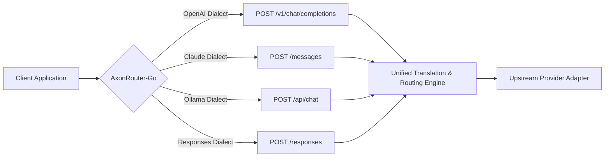

# AxonRouter-Go: API Reference & Dialect Protocol

**Version:** `1.9.59`  
**Router Implementation:** [`internal/handlers/router.go`](file:///workspaces/AxonRouter-Go/internal/handlers/router.go), [`internal/handlers/chat/handler.go`](file:///workspaces/AxonRouter-Go/internal/handlers/chat/handler.go)

---

## 1. Unified Dialect Routing

AxonRouter-Go accepts incoming requests across 4 major LLM dialects and normalizes them into internal unified request representations:



---

## 2. Proxy Surface Endpoints

### 2.1 Chat & Completion Endpoints

| Method | Path | Dialect | Description | Auth Required |
|---|---|---|---|---|
| `POST` | `/v1/chat/completions` | OpenAI | Full OpenAI-compatible chat completion | Client API Key |
| `POST` | `/chat/completions` | OpenAI | Virtual prefix alias for `/v1/chat/completions` | Client API Key |
| `POST` | `/messages` | Claude | Anthropic Messages API compatible | Client API Key |
| `POST` | `/v1/messages` | Claude | Prefixed Anthropic Messages API | Client API Key |
| `POST` | `/messages/count_tokens` | Claude | Token estimation for prompt context | Client API Key |
| `POST` | `/api/chat` | Ollama | Ollama native chat payload format | Client API Key |
| `POST` | `/responses` | Custom | State-preserving conversation responses | Client API Key |
| `POST` | `/responses/compact` | Custom | Memory compactor for active conversations | Client API Key |

### 2.2 Model Catalog Endpoints

| Method | Path | Description | Response Shape |
|---|---|---|---|
| `GET` | `/v1/models` | List all active configured models | `{"object":"list","data":[{"id":"...","owned_by":"..."}]}` |
| `GET` | `/v1/models/{id}` | Inspect specific model metadata & limits | Single model descriptor |
| `GET` | `/v1/models/{kind}` | Filter models by kind: `llm`, `embedding`, `image`, `tts`, `stt`, `video` | Filtered list |
| `GET` | `/api/models/catalog-sync` | Status of remote catalog sync | Sync timestamp and state |
| `POST` | `/api/models/catalog-sync` | Force refresh model definitions from upstream | Trigger confirmation |

### 2.3 Batch & File APIs (OpenAI Parity)

| Method | Path | Description |
|---|---|---|
| `POST` | `/v1/files`, `/files` | Upload file for batch execution |
| `GET` | `/v1/files`, `/files` | List uploaded files |
| `GET` | `/v1/files/{file_id}`, `/files/{file_id}` | Retrieve file metadata |
| `GET` | `/v1/files/{file_id}/content` | Download raw file content |
| `DELETE` | `/v1/files/{file_id}` | Purge uploaded file |
| `POST` | `/v1/batches`, `/batches` | Submit offline asynchronous batch |
| `GET` | `/v1/batches`, `/batches` | List batches and current execution status |
| `GET` | `/v1/batches/{batch_id}` | Retrieve batch progress metrics |
| `POST` | `/v1/batches/{batch_id}/cancel` | Abort in-flight batch job |

### 2.4 Media Generation Endpoints

| Method | Path | Description |
|---|---|---|
| `POST` | `/v1/images/generations` | Generate images (MiniMax H3-Image or legacy image-01) |
| `POST` | `/v1/videos/generations` | Create an asynchronous video job |
| `GET` | `/v1/videos/{id}` | Poll job status |
| `GET` | `/v1/videos/{id}/content` | Stream the finished video from the provider CDN |

### MiniMax model map

| Wire model | Provider / alias | Kind | Upstream | Limits |
|---|---|---|---|---|
| `MiniMax-H3-Image` | `minimax-code-global` / `mmg` | image | `POST https://api.minimax.io/v1/images/generations` | prompt ≤ 32,000 chars; `n` 1–10; `size` = `WIDTHxHEIGHT` (area 655,360–20,000,000 px, ratio 1:3–3:1) or `auto` with `aspect_ratio` (1:3–3:1) / `area` (`1K`,`2K`,`4K`); `output_format` `png`/`jpeg`/`jpg`/`webp`; `response_format` `url`/`b64_json`. |
| `MiniMax-H3-Image-Highspeed` | `mmg` | image | same as H3-Image | Same parameters and limits as `MiniMax-H3-Image`. |
| `minimax-image-01` | `minimax` / `mm` | image (legacy) | `POST https://api.minimaxi.com/v1/images/generations` | Upstream parity: OpenAI-shaped `{model,prompt,n,size,response_format}` body, response passed through unchanged. |
| `MiniMax-H3`, `MiniMax-H3-Highspeed`, `MiniMax-H3-Lite`, `MiniMax-H3-Max` | `mmg` | video | `POST https://api.minimax.io/v2/video_generation` | H3: `768P`/`2K`, 4–15 s; Highspeed/Lite: `480P`/`768P`, 4–15 s; Max: `480P`/`768P`, 5–15 s. |

H3-Image is synchronous but the upstream can hold the response for up to
600 seconds, so the media lane uses a 10-minute response-header timeout only
for those two models. The endpoint is not idempotent — a timed-out request may
still be billed upstream, so the gateway does not replay it. Video create
requests accept an OpenAI-style `prompt` or a `content` array; polling returns
the provider task shape; `/content` streams the finished asset without
forwarding the provider credential to the CDN.

---

## 3. Streaming (Server-Sent Events)

When `stream: true` is provided in the request payload:
- **Response Headers:**
  - `Content-Type: text/event-stream`
  - `Cache-Control: no-cache, no-transform`
  - `Connection: keep-alive`
  - `X-Accel-Buffering: no` (disables buffering in Nginx reverse proxies)
- **Event Framing:**
  - Data chunks formatted as `data: {"id":"...","choices":[{"delta":{"content":"..."}}]}\n\n`
  - Terminal event formatted as `data: [DONE]\n\n`
- **Client Disconnect Handling:**
  - The handler monitors `r.Context().Done()`.
  - Upstream HTTP transport connection is immediately cancelled upon client disconnect to release provider socket and prevent wasted upstream token spend.

---

## 4. Standard Error Envelopes

All errors return JSON envelopes conforming to standard API client expectations:

```json
{
  "error": {
    "message": "Invalid API key provided",
    "type": "authentication_error",
    "code": "invalid_api_key",
    "param": null
  }
}
```

### HTTP Status Codes:
- `400 Bad Request`: Malformed JSON or unparseable dialect payload.
- `401 Unauthorized`: Missing or invalid client API key / expired session.
- `403 Forbidden`: Insufficient permissions or remote default password block.
- `404 Not Found`: Model or requested route not configured in active registry.
- `429 Too Many Requests`: RPM/TPM limit exceeded or provider rate limit encountered.
- `502 Bad Gateway`: Upstream provider unreachable, timeout, or TLS handshake error.
- `504 Gateway Timeout`: Upstream provider exceeded global deadline.

---

## 5. Rate Limiting Headers

When `RequireRateLimit` middleware is active, outgoing responses include:
- `X-RateLimit-Limit-Requests`: Configured requests per minute (RPM).
- `X-RateLimit-Remaining-Requests`: Remaining request quota in sliding window.
- `X-RateLimit-Limit-Tokens`: Configured tokens per minute (TPM).
- `X-RateLimit-Remaining-Tokens`: Remaining token quota in sliding window.
- `Retry-After`: Seconds until quota bucket replenishment (on `429`).
