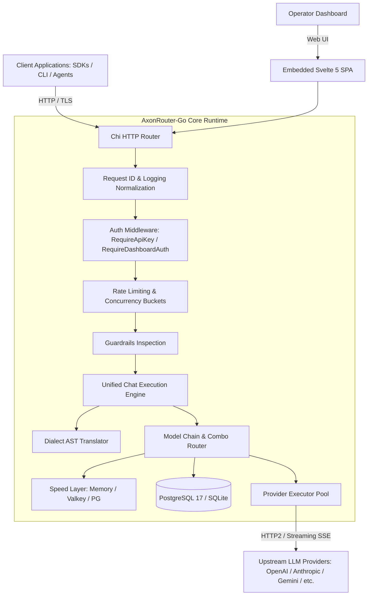

# AxonRouter-Go: System Architecture & Execution Pipeline

**Version:** `1.9.59`  
**Primary Reference:** Root [`ARCHITECTURE.md`](file:///workspaces/AxonRouter-Go/ARCHITECTURE.md)  
**Core Components:** [`cmd/axonrouter-go`](file:///workspaces/AxonRouter-Go/cmd/axonrouter-go), [`internal/app`](file:///workspaces/AxonRouter-Go/internal/app), [`internal/handlers/chat`](file:///workspaces/AxonRouter-Go/internal/handlers/chat), [`internal/translator`](file:///workspaces/AxonRouter-Go/internal/translator)

---

## 1. High-Level Topology



---

## 2. Inbound Request Pipeline

Every incoming completion request traverses a strict, ordered middleware and translation chain:

1. **Path Normalization & ID Injection:**
   - [`internal/middleware/logging.go`](file:///workspaces/AxonRouter-Go/internal/middleware/logging.go) normalizes virtual prefixes (e.g. `/v1/chat/completions` and `/chat/completions` map to the same handler).
   - Injects unique `X-Request-ID` if missing.
2. **Authentication Gate:**
   - Validates client API key against Argon2id hashed credentials.
   - Attaches user identity, allowed models, and custom rate limits to request context.
3. **Rate Limiting & Sliding Windows:**
   - Evaluates RPM (Requests per Minute), TPM (Tokens per Minute), and active concurrency limits.
   - Sheds load with `429 Too Many Requests` when ceilings are reached.
4. **Guardrails & Security Inspection:**
   - Scans input prompts against active regex policies, secret leakage patterns, and prompt injection filters before provider execution.
5. **Dialect Normalization:**
   - [`internal/translator/`](file:///workspaces/AxonRouter-Go/internal/translator) converts OpenAI, Claude, or Ollama inputs into the internal universal schema.
6. **Provider Execution & Cascade:**
   - Selects target provider based on model mapping, account cooldown status, and load-balancing weights.
   - Dispatches via [`internal/proxy/executor/`](file:///workspaces/AxonRouter-Go/internal/proxy/executor/).
7. **Response Transformation & SSE Streaming:**
   - As chunks return, transforms upstream event format into the dialect requested by the caller.

---

## 3. Dialect Translation Subsystem

The translation engine operates on normalized intermediate representations:

```text
Input Request (OpenAI / Claude / Gemini / Ollama)
               │
               ▼
   [internal/translator/request]
               │  AST Normalization:
               │  - Content parts (text, image, audio)
               │  - Tool definitions & tool choices
               │  - System prompts & cache breakpoints
               ▼
   Unified Internal Representation
               │
               ▼
   [internal/proxy/executor/{provider}]
               │  Provider Specific Serialization
               ▼
   Upstream HTTP Request
```

The reverse path converts raw provider SSE streams into consistent client SSE chunks without buffering the full response in RAM.

---

## 4. State, Persistence & Concurrency

- **Durable Storage Authority:** Primary state is persisted in PostgreSQL (or SQLite in lightweight mode) via `internal/db/`.
- **Speed Layer:** Ephemeral data (active rate-limit counters, transient token-bucket leases, provider latency metrics) lives in memory or Valkey via `internal/speedlayer/`.
- **Account Lease Serialization:** When multiple worker nodes or concurrent goroutines route through shared provider accounts, leases are acquired with CAS (Compare-And-Swap) or database row locks to prevent quota exhaustion and account bans.
- **Embedded Dashboard:** The frontend is built from Svelte 5 + Vite, bundled into Go binaries via `embed.FS` in [`web/embed.go`](file:///workspaces/AxonRouter-Go/web/embed.go). Zero external node/npm runtime is required on production hosts.
