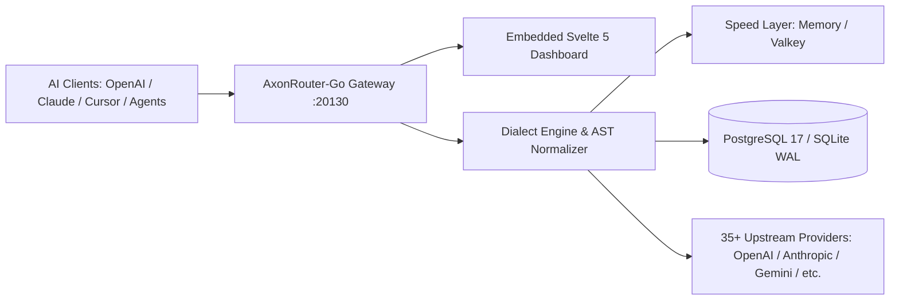
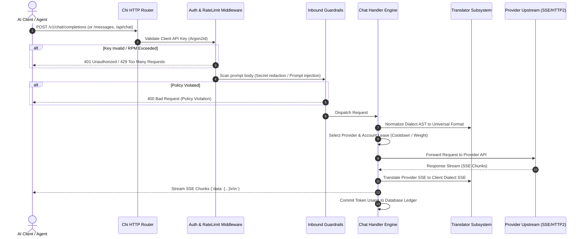

# AxonRouter-Go: Comprehensive Technical Handbook

**Version:** `1.9.59`  
**Binary:** `axonrouter-go`  
**Repository:** `/workspaces/AxonRouter-Go`

---

## 1. Executive Summary

AxonRouter-Go is a production-grade, high-performance LLM proxy gateway and routing engine implemented in pure Go. It serves as a unified abstraction layer connecting diverse LLM clients (OpenAI SDK, Anthropic Claude Code, Ollama CLI, Agentic frameworks) to 35+ upstream AI providers with zero external runtime dependencies.

---

## 2. System Architecture & Request Pipeline

### 2.1 Complete Request Lifecycle

---

## 3. Dialect Translation Subsystem

AxonRouter-Go dynamically bridges protocol differences across leading AI interfaces:

| Client Dialect | Input Path | Output Schema | Target Provider Examples |
|---|---|---|---|
| **OpenAI** | `/v1/chat/completions` | Standard OpenAI SSE/JSON | Groq, DeepSeek, Together, Ollama, OpenAI |
| **Anthropic** | `/messages`, `/v1/messages` | Claude event-stream (`content_block_delta`) | Anthropic, Claude-compatible endpoints |
| **Google Gemini** | Inbound adapter | `generateContent` format | Google Vertex, Gemini AI Studio |
| **Ollama** | `/api/chat` | Ollama native JSON stream | Local Ollama nodes, vLLM |

AST normalization handles:
- Multi-modal content parts (`image_url`, base64 binary, audio).
- Tool definitions, function calling specs, and `tool_choice` constraints.
- System prompt normalization and prompt caching breakpoints.

---

## 4. Routing, Load Balancing & Model Combos

- **Virtual Model Combos:** Configure chains of primary, secondary, and tertiary fallback models.
- **Dynamic Account Leasing:** Distributes volume across pools of keys with automatic $429$ quarantine.
- **Token Saver Engine:** Automatic context optimization, whitespace reduction, and prompt compaction.

---

## 5. Security & Hardening Architecture

- **Zero Plaintext Storage:** Client API keys stored as **Argon2id** verifiers with SHA-256 search indices; provider secrets encrypted via **AES-256-GCM**.
- **Admin Isolation:** Destructive operations (`/api/version/shutdown`, `/api/version/update`) require session cookies or local CLI tokens.
- **CVE-2026-56679 Remote Gate:** Remote access blocked on default password (`123456`) until initialized locally or via `INITIAL_PASSWORD`.
- **IP Clamping:** Configured via `TRUST_PROXY` and `TRUSTED_PROXIES` to prevent rate-limit evasion.

---

## 6. Persistence & Operational Topologies

| Component | Lightweight / Edge Mode | High-Availability Cluster Mode |
|---|---|---|
| **Primary Database** | SQLite (WAL mode, busy timeout 5000ms) | PostgreSQL 17 (pgx pool, migration autocommit) |
| **Speed Layer** | In-memory sliding windows | Valkey / Redis cluster cache |
| **Ingress Proxy** | Direct port `20130` | Nginx reverse proxy with load balancing |
| **Dashboard UI** | Embedded Svelte 5 SPA | Embedded Svelte 5 SPA |

---

## 7. Master Document Cross-Reference

| Document | Primary Scope |
|---|---|
| [`ADMIN-LOGIN.md`](file:///workspaces/AxonRouter-Go/docs/ADMIN-LOGIN.md) | Dashboard authentication, session cookies, rate-limiting, CVE prevention |
| [`API.md`](file:///workspaces/AxonRouter-Go/docs/API.md) | Complete dialect routes, SSE streaming, error envelopes, batch APIs |
| [`ARCHITECTURE.md`](file:///workspaces/AxonRouter-Go/docs/ARCHITECTURE.md) | Inbound middleware pipeline, AST translator, speed layer, concurrency |
| [`DEPLOY.md`](file:///workspaces/AxonRouter-Go/docs/DEPLOY.md) | Single node Compose, cluster Compose, systemd unit, Tailscale setup |
| [`HARDENING.md`](file:///workspaces/AxonRouter-Go/docs/HARDENING.md) | IP trust proxy, Argon2id hashing, AES-256-GCM, guardrails, pprof gating |
| [`OPERATIONS.md`](file:///workspaces/AxonRouter-Go/docs/OPERATIONS.md) | Database backup/restore, Prometheus metrics, updates, maintenance |
| [`PROVIDERS.md`](file:///workspaces/AxonRouter-Go/docs/PROVIDERS.md) | 35+ provider catalog, OAuth token refresh, account leases, combos |
| [`QUALITY.md`](file:///workspaces/AxonRouter-Go/docs/QUALITY.md) | Quality standards, linting, testing architecture, troubleshooting matrix |
| [`README.md`](file:///workspaces/AxonRouter-Go/docs/README.md) | Documentation index, quick start, source map, verification commands |
