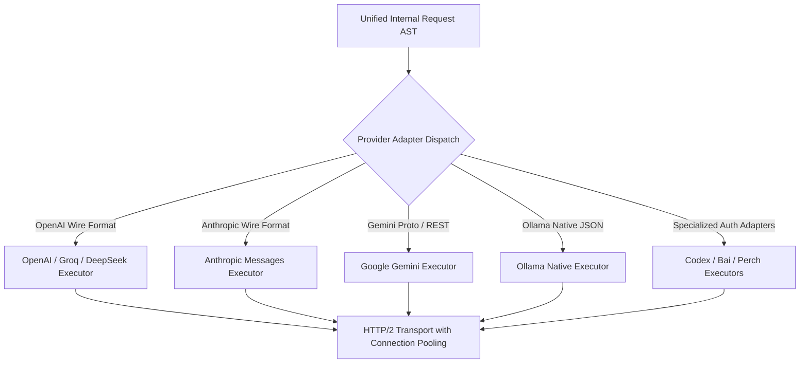

# AxonRouter-Go: Provider Catalog & Integration Reference

**Target Version:** `1.9.59`  
**Provider System:** [`internal/providers/`](file:///workspaces/AxonRouter-Go/internal/providers/), [`internal/proxy/executor/`](file:///workspaces/AxonRouter-Go/internal/proxy/executor/), [`docs/DASHBOARD_PROVIDER_PARITY.md`](file:///workspaces/AxonRouter-Go/docs/DASHBOARD_PROVIDER_PARITY.md)

---

## 1. Supported Provider Ecosystem

AxonRouter-Go supports 35+ upstream providers categorized into 4 operational archetypes:

| Archetype | Key Providers | Authentication Modes | Dialects Supported |
|---|---|---|---|
| **Tier-1 Native** | OpenAI, Anthropic, Google Gemini | API Key, OAuth, Service Account | Chat Completions, Messages, Gemini JSON |
| **High-Throughput / Fast Inference** | Groq, Cerebras, Fireworks, DeepSeek | API Key | OpenAI Chat Completions |
| **Developer & Agent Ecosystems** | Codex, Kiro, Bai, Perch, Cline, Continue, Cursor | Session Tokens, Device Flow, API Key | Custom AST / Emulated Claude / OpenAI |
| **Local & Open Models** | Ollama, LocalAI, vLLM | None / Bearer Token | Ollama Chat, OpenAI Completions |

---

## 2. Upstream Protocol Adaptation

Each provider family is handled by a specialized executor under `internal/proxy/executor/`:



---

## 3. Account Leases & Multi-Credential Load Balancing

For providers supporting multiple configured accounts (e.g. 5 Anthropic API keys or 10 Gemini free-tier accounts):

1. **Round-Robin with Weighting:** Distributes requests proportionally across healthy accounts.
2. **Lease Acquisition:** Goroutines acquire an account lease before dispatching. If an account is currently at its maximum concurrency ceiling, the router selects the next available account.
3. **429 Cooldown & Circuit Breaking:**
   - If a provider returns `429 Too Many Requests` or `insufficient_quota`, the account is automatically quarantined into a cooldown state.
   - Cooldown period respects the `Retry-After` header returned by the provider, or defaults to an exponential backoff (30s → 60s → 300s).
   - The request automatically fails over to the next healthy account in the model chain without returning an error to the client.

---

## 4. OAuth 2.0 & Token Refresh Architecture

Providers requiring browser or token-based authentication (Codex, Google Vertex, etc.):
- **Authorization Callback:** Browsers are redirected to `/callback` where authorization codes are exchanged for refresh and access tokens.
- **Background Refresh Leases:** Access tokens are checked before request execution. If expiration is within 5 minutes, AxonRouter-Go automatically triggers an asynchronous refresh lease using the stored refresh token.
- **Encryption at Rest:** All OAuth refresh tokens and client secrets are encrypted in the database using AES-256-GCM.

---

## 5. Model Combos & Fallback Chains

AxonRouter-Go allows defining composite virtual models ("Combos") that link multiple underlying providers:

```text
Combo: "smart-coding-combo"
  ├─ Primary:   anthropic / claude-3-7-sonnet-20250219
  ├─ Fallback:  openai / gpt-4o
  └─ Safety:    deepseek / deepseek-chat
```

If the primary provider suffers an outage, rate limit, or network failure, the router transparently retries against the fallback model within the same client HTTP stream.
