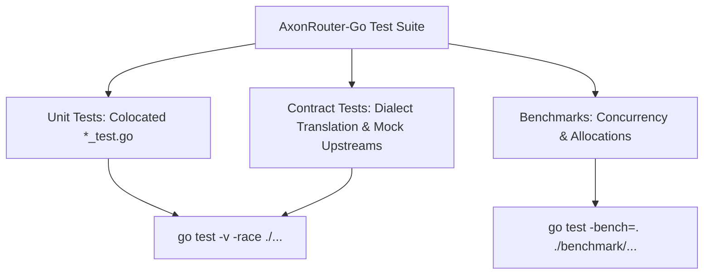

# AxonRouter-Go: Quality, Testing & Reliability Assurance

**Target Version:** `1.9.59`  
**Tooling Authority:** [`Makefile`](file:///workspaces/AxonRouter-Go/Makefile), [`.golangci.yml`](file:///workspaces/AxonRouter-Go/.golangci.yml), [`TECHNICAL_DEBT.md`](file:///workspaces/AxonRouter-Go/TECHNICAL_DEBT.md)

---

## 1. Quality Standards & Engineering Discipline

AxonRouter-Go enforces strict Go engineering standards across the entire codebase:

1. **Explicit Error Handling:** Zero ignored errors. Every error return must be handled, wrapped with context, or logged. Blank identifier error discarding (`_ = err`) is forbidden on critical paths.
2. **Context Propagation:** All network and database operations must accept and respect `context.Context` cancellation to prevent zombie goroutines.
3. **Bounded Memory Allocation:** All body reads must be wrapped with `http.MaxBytesReader` or bounded buffers to defend against memory exhaustion DOS.
4. **Concurrency Safety:** Race-free data structures verified via `go test -race`.

---

## 2. Static Analysis & Linting

Linting is configured in [`.golangci.yml`](file:///workspaces/AxonRouter-Go/.golangci.yml) and enforced via:

```bash
make lint
# runs golangci-lint run ./... --timeout 5m
```

### Active Linters:
- `errcheck`: Flags unhandled error returns.
- `govet`: Suspicious constructs (shadowing, printf format mismatch).
- `staticcheck`: Advanced static analysis and performance diagnostics.
- `unused`: Unused constants, variables, functions, and types.
- `ineffassign`: Ineffectual assignments that produce dead code.

---

## 3. Testing Architecture



### 3.1 Verification Commands
```bash
# Run unit tests across all packages
make test

# Run tests with race detection (strict CI requirement)
go test -race ./internal/...

# Run performance benchmarks
go test -bench=. -benchmem ./benchmark/...
```

---

## 4. Troubleshooting Matrix

| Symptom | Probable Root Cause | Resolution / Fix |
|---|---|---|
| `403 Forbidden` on remote `/login` | Remote host attempting login with default password `123456` | Set `INITIAL_PASSWORD` environment variable or connect via SSH port forward `ssh -L 20130:localhost:20130`. |
| `429 Too Many Requests` (Immediate) | Key RPM/TPM limit exhausted or IP lockout bucket triggered | Check `X-RateLimit-Reset` header. Verify `TRUST_PROXY=true` if behind a reverse proxy. |
| Streaming disconnects after 60s | Reverse proxy timeout or response buffering enabled | Add `proxy_buffering off;` and `proxy_read_timeout 300s;` in Nginx upstream configuration. |
| High database lock contention | SQLite WAL checkpoint backlog or missing index on usage ledger | Verify SQLite journal mode is `WAL`. For high-throughput clusters, migrate to PostgreSQL via `DATABASE_URL`. |
| Memory spikes during file upload | Unbounded file buffering | Check `LimitRequestBody` middleware and ensure file uploads stream to disk instead of RAM. |

---

## 5. Technical Debt & Upstream Parity Tracking

All tracked architectural gaps and remaining upstream parity items are continuously audited in:
- [`TECHNICAL_DEBT.md`](file:///workspaces/AxonRouter-Go/TECHNICAL_DEBT.md) — Hotspots, memory allocations, and refactoring targets.
- [`docs/PARITY-REMAINING.md`](file:///workspaces/AxonRouter-Go/docs/PARITY-REMAINING.md) — Upstream parity itemization and status.
